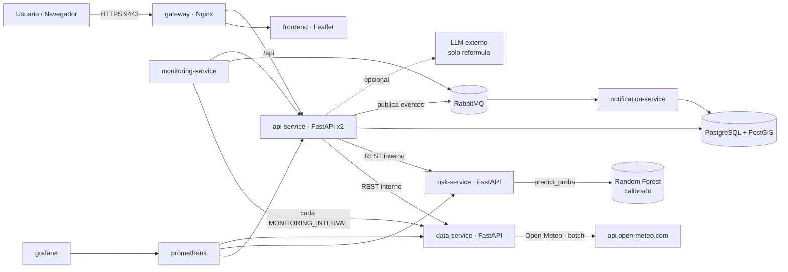
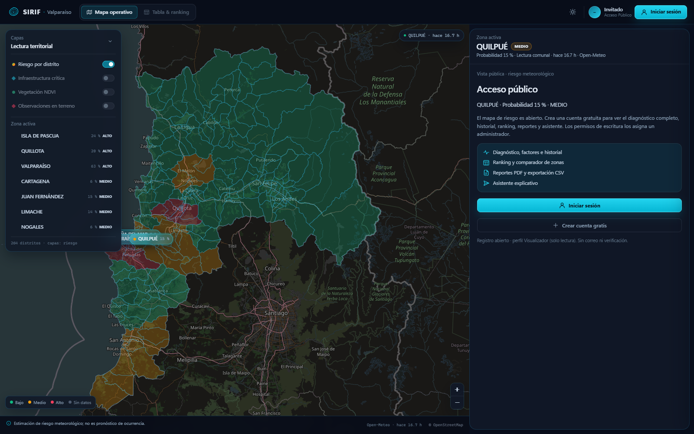
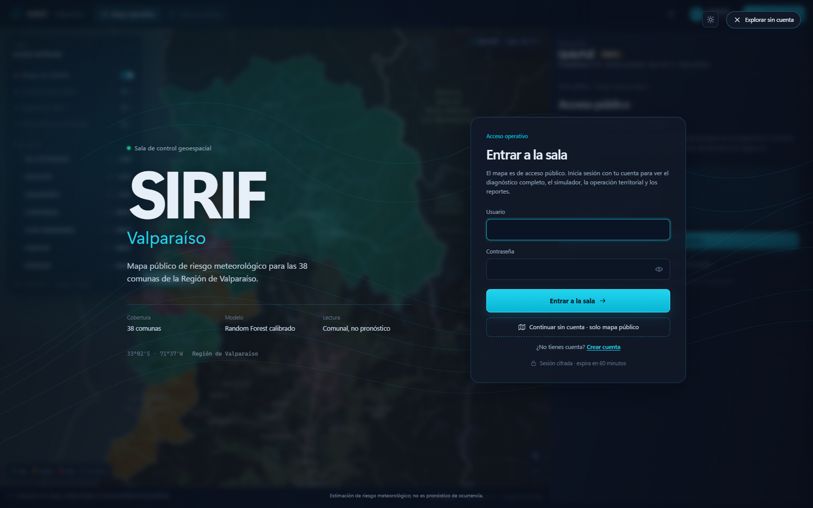
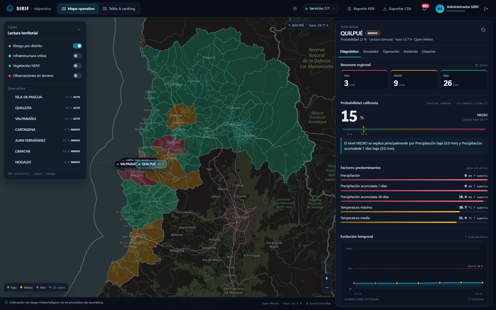
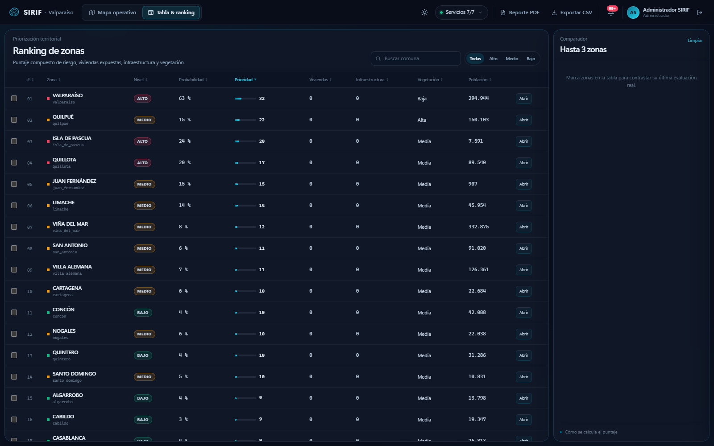
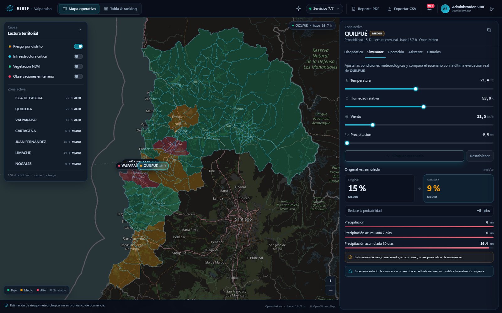
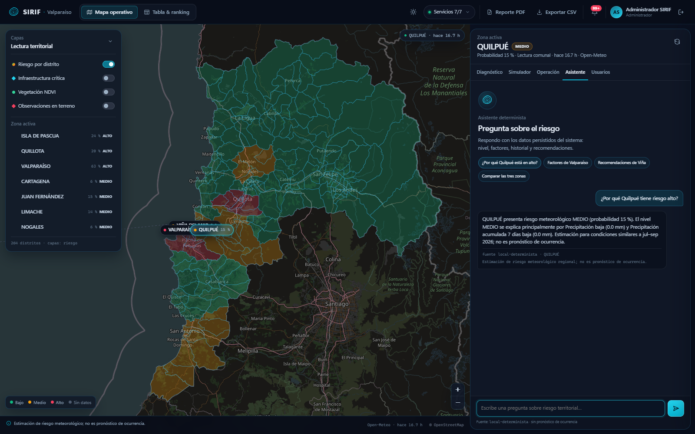
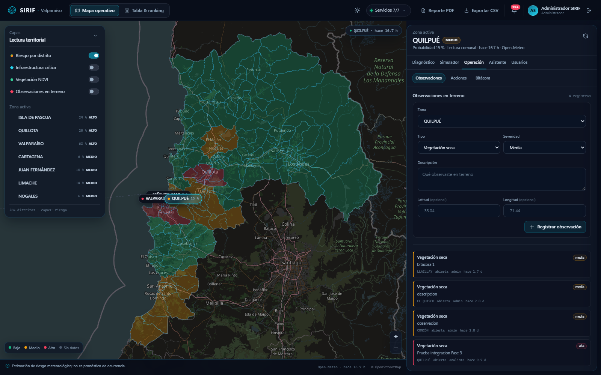
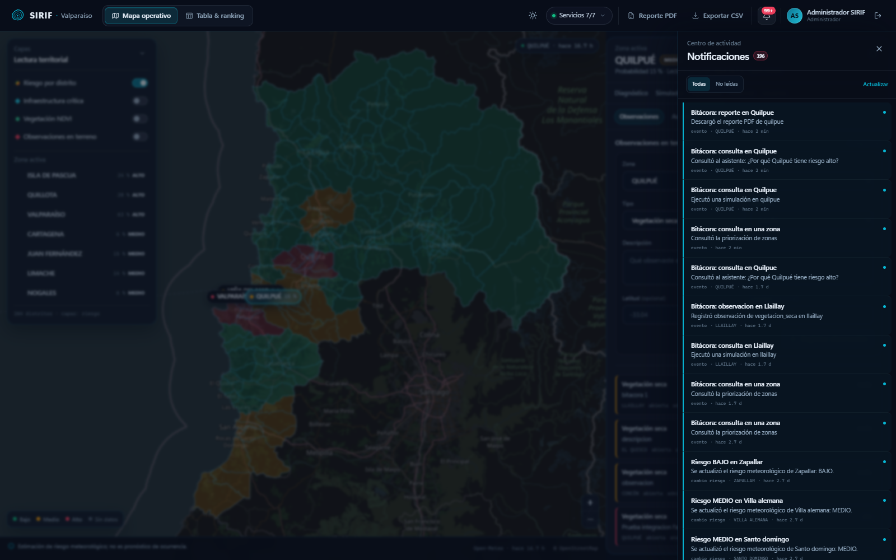
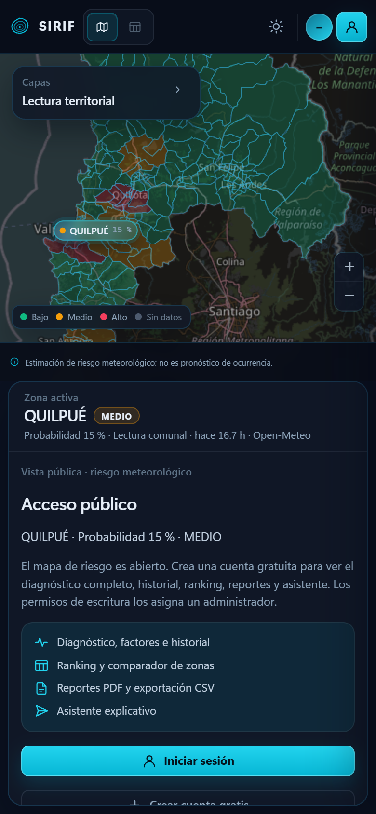

# SIRIF — Sistema Inteligente de Riesgo de Incendios Forestales

[](https://github.com/frfernandini/arquitectura/actions/workflows/ci.yml)

Proyecto semestral de la asignatura **Arquitectura de Sistemas de Inteligencia Artificial (ITY1102)**.

Caso: sistema de apoyo a la prevención y clasificación de riesgo meteorológico de incendios forestales en la Región de Valparaíso.

SIRIF clasifica el nivel de riesgo (**BAJO / MEDIO / ALTO**) por comuna y lo proyecta sobre los distritos censales de Quilpué, Viña del Mar y Valparaíso. Integra datos reales de CONAF, IDE Chile/INE, EMAS y Open-Meteo, y expone el resultado mediante una plataforma web con mapa, panel operativo, alertas, reportes y asistente.

> El sistema **no predice incendios**: estima susceptibilidad meteorológica diaria como apoyo al análisis preventivo.

---

## Índice

1. [Entregables](#entregables)
2. [Arquitectura](#arquitectura)
3. [Código](#código)
4. [Ejecución](#ejecución)
5. [Dockerfile y configuraciones](#dockerfile-y-configuraciones)
6. [Pruebas](#pruebas)
7. [Documentación](#documentación)
8. [Modelo y referencia](#modelo-y-referencia)
9. [CI/CD](#cicd)
10. [Evidencias](#evidencias)
11. [Seguridad](#seguridad)
12. [Estado y limitaciones](#estado-y-limitaciones)
13. [Enlaces](#enlaces)
14. [Declaración de uso de IA](#declaración-de-uso-de-ia)
15. [Referencias](#referencias)

---

## Entregables

| Requisito | Dónde encontrarlo |
|---|---|
| **Código** | 9 módulos en la raíz: `gateway/`, `frontend/`, `api-service/`, `data-service/`, `risk-service/`, `monitoring-service/`, `notification-service/`, `shared/`, `ml-pipeline/` ([ver estructura](#estructura-del-repositorio)) |
| **README** | Este archivo: arquitectura, ejecución, configuración, pruebas, modelo, CI/CD y enlaces |
| **Dockerfile / configuraciones** | 7 `Dockerfile`, `docker-compose.yml`, `gateway/nginx.conf`, `monitoring/prometheus.yml`, `monitoring/grafana/provisioning/`, `db/init.sql`, `.env.example` ([ver detalle](#dockerfile-y-configuraciones)) |
| **Pruebas** | 108 pruebas automatizadas en 7 suites + evidencia de ejecución en `docs/evidencias/pruebas-2026-11-28.txt` ([ver detalle](#pruebas)) |
| **Documentación** | `docs/superpowers/specs/` (2 diseños), `docs/superpowers/plans/` (4 planes), `datos_externos/conaf/README.md` ([ver detalle](#documentación)) |
| **Modelo o referencia** | `risk-service/modelo_riesgo.pkl` (regional), `risk-service/modelo_riesgo_comunal.pkl` (comunal, generado), `ml-pipeline/train_honesto.py`, `ml-pipeline/train_comunal.py` y metadatos JSON ([ver detalle](#modelo-y-referencia)) |
| **CI/CD** | `.github/workflows/ci.yml` (pruebas + build) y `.github/workflows/deploy.yml` (despliegue a EC2) ([ver detalle](#cicd)) |
| **Evidencias** | Capturas de la interfaz en `docs/evidencias/`, ficha PDF real, registro de pruebas y metadatos del modelo ([ver detalle](#evidencias)) |
| **Enlaces** | Repositorio, servicios locales, fuentes de datos y documentación técnica ([ver detalle](#enlaces)) |

---

## Arquitectura

Arquitectura de **microservicios event-driven** con comunicación asíncrona vía RabbitMQ y un API Gateway (Nginx) como único punto de entrada.



### Servicios

| Servicio | Descripción | Puerto interno |
|---|---|---|
| `gateway` | Nginx: TLS, API Gateway, reenvío de JWT, rate limiting, security headers y balanceo round-robin. | 80 / 443 |
| `frontend` | Aplicación web estática (HTML/CSS/JS + Leaflet local). Mapa, panel, simulador, alertas, reportes. | 80 |
| `api-service` | FastAPI: consulta de riesgo, panel, historial, simulador, alertas, usuarios, reportes PDF/CSV y asistente. | 8000 |
| `data-service` | Ingesta real: IDE/INE, CONAF y EMAS en PostGIS al arrancar; sincroniza Open-Meteo en lote. | 8000 |
| `risk-service` | FastAPI con los modelos Random Forest (comunal y regional) y la lógica de umbrales. | 8001 |
| `monitoring-service` | Worker único: dispara la ingesta y publica `monitoreo.zona` en RabbitMQ. | — |
| `notification-service` | Consume eventos de riesgo y genera alertas/notificaciones. | — |
| `rabbitmq` | Bus de eventos. | 5672 / 15672 |
| `db` | PostgreSQL 16 + PostGIS 3.4. | 5432 |
| `prometheus` | Recolección de métricas. | 9090 |
| `grafana` | Visualización de métricas. | 3000 |
| `node-exporter` | Métricas del host. | 9100 |
| `cadvisor` | Métricas de contenedores. | 8080 |

### Flujo principal

1. `data-service` carga una sola vez las capas territoriales (IDE/INE), los históricos de CONAF y la climatología base EMAS en PostgreSQL + PostGIS, registrando fuente y trazabilidad.
2. `monitoring-service` dispara cada `MONITORING_INTERVAL` (30 s en desarrollo, 3600 s en producción) el endpoint interno `POST /datos/sincronizar`.
3. `data-service` consulta Open-Meteo en una petición batch para todas las zonas, guarda las mediciones en `variable_ambiental` y conserva el último valor válido si la API falla. También envía el lote NDVI opcional.
4. `monitoring-service` publica `monitoreo.zona`; `api-service` infiere con `risk-service` usando las features reales (ventanas móviles de 7 y 30 días) y guarda el resultado en PostgreSQL.
5. La API expone `/api/riesgo/todas` con nivel, probabilidad, fuente y antigüedad de los datos.
6. El frontend colorea cada distrito con el riesgo comunal vigente y muestra fuente y hora de la última medición.

---

## Código

### Stack por módulo

| Módulo | Tecnología | Rol |
|---|---|---|
| `gateway/` | Nginx + OpenSSL | TLS autofirmado, proxy, reenvío de JWT, límites de tasa, CSP |
| `frontend/` | HTML + CSS + JS ES6 + Leaflet 1.9 (local) | SPA sin build, mapa, panel, tema claro/oscuro |
| `api-service/` | FastAPI + psycopg2 + ReportLab + pika | Orquestación, contratos JSON, reportes, asistente |
| `data-service/` | FastAPI + httpx + psycopg2 | Ingesta batch, parsers CSV/GeoJSON, PostGIS |
| `risk-service/` | FastAPI + scikit-learn + pandas | Inferencia y umbrales |
| `monitoring-service/` | Python + pika + httpx | Scheduler de ingesta y heartbeat |
| `notification-service/` | Python + pika | Consumo de eventos y alertas |
| `shared/` | Python | Contrato de features, umbrales y explicabilidad |
| `ml-pipeline/` | pandas + scikit-learn | Entrenamiento, calibración, evaluación y EDA |

### Estructura del repositorio

```
arquitectura/
├── .github/workflows/
│   ├── ci.yml                     # pruebas + build de imágenes
│   └── deploy.yml                 # despliegue SSH a EC2
├── api-service/
│   ├── main.py                    # API principal (~3.400 líneas)
│   ├── auth.py                    # JWT, roles, PBKDF2
│   ├── test_main.py               # 53 pruebas
│   ├── test_pdf_mapa.py           # 3 pruebas (mapa de la ficha PDF)
│   ├── requirements.txt
│   └── Dockerfile
├── data-service/
│   ├── main.py, ingestion.py, parsers.py, db.py
│   ├── tests/                     # 17 pruebas
│   ├── requirements.txt, requirements-dev.txt
│   └── Dockerfile
├── risk-service/
│   ├── main.py                    # /clasificar, /modelos, explicabilidad
│   ├── modelo_riesgo.pkl          # modelo regional (versionado)
│   ├── modelo_riesgo_comunal.pkl  # modelo comunal (no versionado, 296 MB)
│   ├── test_main.py               # 18 pruebas
│   └── Dockerfile
├── monitoring-service/            # worker de ingesta + heartbeat (3 pruebas)
├── notification-service/          # consumidor de eventos (6 pruebas)
├── shared/
│   ├── riesgo.py                  # 9 features, monotonías, umbrales
│   └── test_riesgo.py             # 3 pruebas
├── ml-pipeline/
│   ├── train_honesto.py           # modelo regional
│   ├── train_comunal.py           # modelo comunal
│   ├── descargar_clima.py         # descarga Open-Meteo Archive
│   ├── eda.py
│   ├── model_metadata.json        # métricas del modelo regional
│   ├── model_metadata_comunal.json
│   ├── matriz_correlacion.png     # evidencia EDA
│   ├── ndvi_ejemplo.json          # lote NDVI de ejemplo
│   ├── openmeteo_entrenamiento.csv
│   └── test_train_*.py            # 8 pruebas
├── frontend/
│   ├── index.html, styles.css, app.js
│   ├── leaflet.js, leaflet.css, theme-init.js   # recursos locales
│   ├── data/                      # distritos y comunas (GeoJSON/JSON)
│   └── Dockerfile
├── gateway/
│   ├── nginx.conf, entrypoint.sh, Dockerfile
├── db/init.sql                    # DDL idempotente
├── monitoring/
│   ├── prometheus.yml
│   └── grafana/provisioning/      # datasource + dashboard
├── docs/
│   ├── superpowers/specs/         # diseños técnicos
│   ├── superpowers/plans/         # planes de implementación
│   └── evidencias/                # capturas de UI, ficha PDF, script y pruebas
├── datos_externos/conaf/          # scripts de construcción del dataset + README
├── docker-compose.yml
├── .env.example
└── README.md
```

### Endpoints principales (`api-service`)

| Área | Endpoints |
|---|---|
| Público (sin sesión) | `GET /api/publico/zonas`, `GET /api/publico/distritos`, `POST /api/publico/registro` |
| Autenticación | `POST /token` (JWT), roles `admin` / `analista` / `visualizador` |
| Riesgo | `GET /api/riesgo/todas`, `/api/riesgo/{zona}`, `/historial`, `/explicacion`, `/recomendaciones` |
| Datos | `GET /api/datos/{zona}`, `/historico`, `/infraestructura`, `/vegetacion`, `GET /api/datos/distritos` |
| Operación | `GET /api/panel/resumen`, `/api/prioridad`, `/api/comparar`, `POST /api/simular` |
| Gestión | `GET/POST/PATCH/DELETE /api/usuarios`, `/api/observaciones`, `/api/acciones`, `/api/infraestructura` |
| Alertas | `GET/PATCH /api/alertas`, `GET /api/notificaciones`, `POST /api/notificaciones/{id}/leida` |
| Reportes | `GET /api/reportes/{zona}/pdf`, `GET /api/exportar/pdf`, `GET /api/exportar/csv` |
| Asistente | `POST /api/asistente/preguntar` (motor determinista; LLM opcional solo reformula) |
| Observabilidad | `GET /health`, `GET /metrics` |

Los contratos JSON son **aditivos**: `risk-service` sigue aceptando clientes antiguos y `api-service` conserva los campos ya publicados.

---

## Ejecución

### Requisitos

- Docker Desktop con Docker Compose v2
- Navegador web moderno

### Puesta en marcha

```bash
cp .env.example .env          # ajustar secretos
docker compose --compatibility up -d --build
```

El flag `--compatibility` permite que Compose respete `deploy.replicas` en `api-service`.

Parar, reanudar y eliminar:

```bash
docker compose stop      # detener
docker compose start     # reanudar
docker compose down      # eliminar contenedores (conserva volúmenes)
```

### URLs y credenciales

| Servicio | URL | Credenciales |
|---|---|---|
| Frontend (HTTPS) | **https://localhost:9443** | `admin` / `sirif2026` |
| Frontend (HTTP → redirige) | http://localhost:9080 | — |
| Mapa público (sin sesión) | https://localhost:9443 | — |
| API de riesgo | https://localhost:9443/api/riesgo/todas | `admin` / `sirif2026` |
| API pública de zonas | https://localhost:9443/api/publico/zonas | — |
| Prometheus | http://127.0.0.1:9090 | — |
| Grafana | http://127.0.0.1:3000 | `admin` / `admin` (configurable) |
| RabbitMQ | http://127.0.0.1:15672 | `sirif` / `sirif2026` |

Roles de desarrollo: `admin`, `analista` y `visualizador` (los tres con `sirif2026` en el `.env` de ejemplo). En producción se deben definir hashes propios.

### Acceso público y sesión

El mapa de riesgo es de **acceso público**: al entrar sin sesión se muestran las 38 comunas coloreadas, la leyenda y el nivel/probabilidad de la comuna seleccionada. `/api/publico/zonas` y `/api/publico/distritos` son de solo lectura, no reciben parámetros y no exponen usuarios, bitácora, acciones ni factores explicativos.

El resto de la plataforma (diagnóstico, historial, ranking, simulador, operación territorial, alertas, usuarios, reportes y exportaciones) exige **iniciar sesión**.

El **registro es autoservicio** desde la pantalla de login: con usuario y contraseña (sin correo) se crea al instante una cuenta `visualizador`. El servidor fija el rol; el usuario no puede auto-elevarse. La asignación de `analista` o `admin`, la desactivación y el reseteo de contraseñas son exclusivos del administrador.

La interfaz incluye **tema claro y oscuro**, con detección inicial del tema del sistema y preferencia persistida en `localStorage` (`sirif_tema`).

### Escalado y balanceo

`api-service` corre con 2 réplicas declaradas en `docker-compose.yml` (`deploy.replicas: 2`); Nginx balancea por round-robin. Verificación:

```bash
docker compose ps
```

### Monitoreo

Prometheus scrapea cada 15 s `/metrics` de los servicios FastAPI instrumentados. Grafana muestra RPS, latencia p95, errores por segundo, CPU/RAM del host y contenedores activos.

```bash
1..200 | ForEach-Object { curl.exe -s -u admin:sirif2026 https://localhost:9443/api/riesgo/todas --insecure > $null }
```

---

## Dockerfile y configuraciones

### Imágenes

| Archivo | Base | Contenido |
|---|---|---|
| `gateway/Dockerfile` | `nginx:alpine` | Nginx + OpenSSL; `entrypoint.sh` genera el certificado autofirmado si falta |
| `frontend/Dockerfile` | `nginx:alpine` | Sirve los archivos estáticos; sin build de Node |
| `api-service/Dockerfile` | `python:3.11-slim` | Uvicorn en el puerto 8000 |
| `data-service/Dockerfile` | `python:3.11-slim` | Uvicorn en el puerto 8000 |
| `risk-service/Dockerfile` | `python:3.11-slim` | Uvicorn 8001; copia `modelo_riesgo.pkl` y, si existe, el comunal |
| `monitoring-service/Dockerfile` | `python:3.11-slim` | Worker de ingesta |
| `notification-service/Dockerfile` | `python:3.11-slim` | Consumidor de RabbitMQ |

### Configuraciones

| Archivo | Función |
|---|---|
| `docker-compose.yml` | Orquestación de 13 servicios, redes, volúmenes, healthchecks, réplicas y límites de recursos |
| `.env.example` | Plantilla de secretos y parámetros (copiar a `.env`, que no se versiona) |
| `gateway/nginx.conf` | TLS, `auth_request` JWT, rate limits, CSP y cabeceras de seguridad |
| `gateway/entrypoint.sh` | Generación idempotente del certificado en el volumen `gateway_tls` |
| `db/init.sql` + `data-service/db.py` | DDL idempotente: distritos, zonas, variables, riesgo, alertas, bitácora, usuarios, infraestructura |
| `monitoring/prometheus.yml` | Targets de scraping de los servicios |
| `monitoring/grafana/provisioning/` | Datasource Prometheus y dashboard provisionado |
| `ml-pipeline/model_metadata*.json` | Métricas y umbrales publicados por cada modelo |

### Variables de entorno principales

| Variable | Default | Descripción |
|---|---|---|
| `DATABASE_URL` | — | Conexión PostgreSQL/PostGIS (obligatoria) |
| `JWT_SECRET` | — | Firma de tokens (obligatoria, fail-fast) |
| `INTERNAL_TOKEN` | — | Protege llamadas internas (`/datos/*`) |
| `MONITORING_INTERVAL` | `3600` | Segundos entre ciclos de ingesta (30 en desarrollo) |
| `OPEN_METEO_URL` | `https://api.open-meteo.com/v1/forecast` | Endpoint meteorológico |
| `MODEL_VERSION` | `rf-clima-region-v2` | Versión del modelo regional por defecto |
| `UMBRAL_ALTO_COMUNAL` | `0.15` | Umbral ALTO del modelo comunal |
| `UMBRAL_MEDIO_COMUNAL` | `0.05` | Umbral MEDIO del modelo comunal |
| `UMBRAL_ALERTA` | `0.50` | Probabilidad que dispara alerta operacional |
| `PESO_RIESGO`, `PESO_VIVIENDAS`, `PESO_INFRA`, `PESO_VEGETACION` | `0.5/0.2/0.15/0.15` | Pesos del ranking de prioridad (se normalizan) |
| `NDVI_FILE` / `NDVI_URL` | `ndvi_ejemplo.json` / vacío | Lote de vegetación (opcional) |
| `LLM_URL` / `LLM_API_KEY` / `LLM_MODEL` | vacío | LLM opcional que **solo reformula** respuestas del asistente |

Los secretos se inyectan por variables de entorno; `.env` está en `.gitignore`.

---

## Pruebas

La suite usa **pytest** y se ejecuta por módulo. Total actual: **108 pruebas**.

| Suite | Comando | Pruebas | Cobertura |
|---|---|---|---|
| `shared` | `cd shared && pytest` | 3 | Contrato de features, monotonías y umbrales |
| `ml-pipeline` | `cd ml-pipeline && pytest` | 8 | Features, splits temporales/espaciales y calibración |
| `data-service` | `cd data-service && pytest tests` | 17 | Parsers CSV/GeoJSON, endpoints e ingesta |
| `risk-service` | `cd risk-service && pytest` | 18 | `/clasificar`, fallback regional, umbrales y explicabilidad |
| `api-service` | `cd api-service && pytest` | 53 | Endpoints, roles, reportes, asistente, CSV y PDF |
| `monitoring-service` | `cd monitoring-service && pytest` | 3 | Ciclo de ingesta y heartbeat |
| `notification-service` | `cd notification-service && pytest` | 6 | Consumo de eventos y alertas |

Ejecución completa:

```bash
for d in shared ml-pipeline data-service risk-service api-service monitoring-service notification-service; do
  (cd "$d" && python -m pytest . -q)
done
```

En `data-service`, `pytest.ini` fija `testpaths = tests`, por lo que `pytest` y `pytest tests` son equivalentes.

La prueba `test_load.py` (raíz) es un script de carga manual contra el stack levantado; no forma parte de la suite ni del CI.

### Evidencia de ejecución

`docs/evidencias/pruebas-2026-11-28.txt` contiene la salida real de las 7 suites (108 pruebas, 0 fallos) generada con Python 3.15 + pytest.

### Verificación funcional y de interfaz

Durante el desarrollo se ejecutaron verificaciones E2E con **Playwright** contra el stack en `https://localhost:9443` (certificado autofirmado, `ignore_https_errors`):

- 53 comprobaciones funcionales (login por rol, mapa, panel, alertas, simulador, reportes, asistente).
- 14 comprobaciones de la capa base (tiles reales, fallback sin red, encuadre, crédito OSM, consola limpia).
- Comprobación responsive a 390×844 sin desbordes horizontales.

Esos scripts no se versionan; se regeneran con Playwright + Chrome contra el stack local. El script de captura (`docs/evidencias/capturar_evidencias.py`) y las capturas resultantes sí están versionados (ver [Evidencias](#evidencias)).

---

## Documentación

| Documento | Contenido |
|---|---|
| `docs/superpowers/specs/2026-11-17-ingesta-real.md` | Diseño de la ingesta real batch horaria |
| `docs/superpowers/specs/2026-11-18-reentrenamiento-honesto.md` | Diseño del reentrenamiento con clima real y calibración |
| `docs/superpowers/plans/2026-11-18-reentrenamiento-honesto.md` | Plan de implementación del modelo honesto |
| `docs/superpowers/plans/roadmap-20-funciones.md` | Roadmap de las 20 funcionalidades operativas |
| `docs/superpowers/plans/refactorizacion-pendiente.md` | Backlog de refactorización sobre el código actual |
| `docs/superpowers/plans/analisis-post-ejecucion.md` | Diagnóstico posterior a la ejecución del roadmap |
| `datos_externos/conaf/README.md` | Construcción del dataset CONAF (filas, columnas, scripts) |

Complementos en el propio código:

- Docstrings de módulo en `data-service/ingestion.py`, `risk-service/main.py` y `shared/riesgo.py`.
- `ml-pipeline/model_metadata.json` y `model_metadata_comunal.json`: métricas, umbrales, features y fecha de entrenamiento.
- `GET /docs` de FastAPI en cada servicio para el contrato OpenAPI interactivo.
- Este README como documento de entrega.

---

## Modelo y referencia

SIRIF usa **clasificación supervisada con Random Forest calibrado**, en dos escalas.

### Modelo comunal — operativo

- **Versión:** `rf-comunal-clima-v1` (`ml-pipeline/train_comunal.py`).
- **Datos:** CONAF 2017–2025 de la Región de Valparaíso (36 comunas, 103.428 filas comuna-día) + clima ERA5 de Open-Meteo.
- **Objetivo:** `y = 1` si ese día la comuna registró al menos un incendio (prevalencia 3,06 %).
- **Algoritmo:** `RandomForestClassifier` (500 árboles, `min_samples_leaf=5`, `random_state=42`) + `CalibratedClassifierCV` con calibración sigmoide (Platt) y 5 folds.
- **Features:** 9 climáticas diarias + `mes`/`mes_sin`/`mes_cos` + 36 indicadores de comuna.
- **Métricas:** validación temporal 2017–2023 → 2024–2025 con AUC 0,760 / AP 0,124 / Brier 0,037; validación espacial 5-fold por comuna con AUC 0,729 / AP 0,069 / Brier 0,029.
- **Umbrales operativos (probabilidad absoluta):** ALTO ≥ 15 %, MEDIO ≥ 5 %.
- **Artefacto:** `risk-service/modelo_riesgo_comunal.pkl` (296 MB, **no versionado**; se genera con `python ml-pipeline/train_comunal.py`). Si falta, `risk-service` usa el modelo regional como fallback.

### Modelo regional — respaldo

- **Versión:** `rf-clima-region-v2` (`ml-pipeline/train_honesto.py`).
- **Datos:** CONAF de las 16 regiones y clima Open-Meteo `ecmwf_ifs025` (ventana jul–sep 2026).
- **Objetivo:** día de actividad alta (`>5 incendios` o `>100 ha`).
- **Features:** 9 climáticas con ventanas de 7 y 30 días + indicadores de región.
- **Métricas:** validación temporal AUC 0,662 / AP 0,523 / Brier 0,191 (tasa base: AUC 0,632 / Brier 0,201).
- **Umbrales:** ALTO ≥ 0,20, MEDIO ≥ 0,08.
- **Artefacto:** `risk-service/modelo_riesgo.pkl` (versionado), metadatos en `ml-pipeline/model_metadata.json`.

### Las 9 variables compartidas

Definidas una sola vez en `shared/riesgo.py` (`FEATURES_CLIMA`), con restricciones monótonas:

`TEMP_MED`, `TEMP_MAX`, `HUMEDAD_REL`, `VEL_VIENTO`, `PRECIPITACION`, `precip_7d`, `precip_30d`, `temp_media_7d`, `humedad_7d`.

Más temperatura y sequedad aumentan el riesgo; más humedad y lluvia lo reducen.

### Flujo de inferencia

```
data-service  → 9 features (ventanas 7/30 d) → api-service → risk-service /clasificar
risk-service  → predict_proba → calibración → umbrales → nivel + puntaje 0–15 + factores
api-service   → snapshot en resultado_riesgo → alertas si cambia el nivel → frontend
```

- Puntaje: `round(min(1, p / umbral_alto) * 15)`.
- Cuando la comuna no está en el modelo comunal (p. ej. Isla de Pascua o Juan Fernández), se usa el regional y se informa `version_modelo`.
- El distrito **hereda** el riesgo de su comuna; no hay inferencia distrital.

### Reentrenamiento

```bash
python ml-pipeline/descargar_clima.py    # ventana regional (opcional, requiere red)
python ml-pipeline/train_honesto.py      # modelo regional
python ml-pipeline/train_comunal.py      # modelo comunal
```

---

## CI/CD

### Integración continua — `.github/workflows/ci.yml`

Se ejecuta en `push` y `pull_request` a `main` y `develop`:

1. Checkout y Python 3.11.
2. Instala dependencias de todos los servicios.
3. Ejecuta las 7 suites de pruebas (`shared`, `ml-pipeline`, `data-service`, `risk-service`, `api-service`, `monitoring-service`, `notification-service`).
4. Verifica que `docker compose build` construya todas las imágenes.

### Despliegue continuo — `.github/workflows/deploy.yml`

En cada `push` a `main`, `appleboy/ssh-action` entra por SSH a la instancia EC2 configurada y ejecuta:

```bash
cd ~/arquitectura
git pull origin main
docker compose up -d --build
docker image prune -f
```

Secretos requeridos en GitHub: `EC2_HOST`, `EC2_USER`, `EC2_SSH_KEY`.

> El despliegue usa el certificado autofirmado del gateway. Para producción real se recomienda una CA válida (p. ej. Let's Encrypt) y habilitar HSTS.

---

## Evidencias

### Capturas de la interfaz

Capturadas contra el stack en ejecución (`https://localhost:9443`, tema oscuro, 1600×1000; móvil 390×844).

| Vista | Captura |
|---|---|
| Mapa público (sin sesión) | <a href="docs/evidencias/01-mapa-publico.png"></a> |
| Pantalla de acceso | <a href="docs/evidencias/02-login.png"></a> |
| Diagnóstico (admin) | <a href="docs/evidencias/03-diagnostico.png"></a> |
| Ranking y tabla | <a href="docs/evidencias/04-ranking.png"></a> |
| Simulador | <a href="docs/evidencias/05-simulador.png"></a> |
| Asistente determinista | <a href="docs/evidencias/06-asistente.png"></a> |
| Operación territorial | <a href="docs/evidencias/07-operacion.png"></a> |
| Centro de actividad | <a href="docs/evidencias/08-alertas.png"></a> |
| Vista móvil (390×844) | <a href="docs/evidencias/09-movil-mapa.png"></a> |

Los archivos se pueden abrir a tamaño completo desde cada enlace.

### Artefactos

| Evidencia | Archivo | Qué demuestra |
|---|---|---|
| Capturas de interfaz | `docs/evidencias/01-…09-*.png` | UI real del stack en tema oscuro y vista móvil |
| Script de captura | `docs/evidencias/capturar_evidencias.py` | Reproduce las capturas y la ficha PDF con Playwright |
| Ejecución de pruebas | `docs/evidencias/pruebas-2026-11-28.txt` | 108 pruebas en 7 suites, 0 fallos |
| Ficha PDF real | `docs/evidencias/ficha-riesgo-quilpue.pdf` | Reporte generado por `GET /api/reportes/quilpue/pdf` con el mapa de distritos corregido |
| Métricas del modelo regional | `ml-pipeline/model_metadata.json` | AUC, AP, Brier, features, umbrales y fecha de entrenamiento |
| Métricas del modelo comunal | `ml-pipeline/model_metadata_comunal.json` | Validación temporal/espacial, prevalencia y curvas |
| Análisis exploratorio | `ml-pipeline/matriz_correlacion.png` | Correlación entre variables climáticas y ocurrencia |
| Construcción del dataset | `datos_externos/conaf/README.md` | Filas por archivo y linaje desde IDE Minagri |
| Salida del modelo en vivo | `GET /api/riesgo/todas` | 38 zonas con `version_modelo` y probabilidad (requiere stack activo) |

Reproducir la evidencia:

```bash
docker compose --compatibility up -d --build
pip install playwright httpx
python docs/evidencias/capturar_evidencias.py   # capturas + ficha PDF
cd api-service && python -m pytest -q           # y análogamente en cada módulo
```

---

## Seguridad

Controles implementados en el gateway Nginx:

- Autenticación JWT Bearer en `/api/`: el gateway reenvía el token y `api-service` valida firma y rol (`require_rol`).
- Acceso público de solo lectura en `/api/publico/` (mapa sin sesión, sin datos operativos).
- Rate limiting: 10 req/s por IP con ráfaga de 20; auto-registro 3 cuentas/min por IP; reportes, exportaciones y asistente limitados a 2 req/s.
- `/api/datos/sincronizar` bloqueado desde el exterior (solo red interna con `INTERNAL_TOKEN`).
- Contraseñas PBKDF2 (mínimo 8 caracteres); el registro solo puede crear `visualizador`.
- Security headers: X-Frame-Options, X-Content-Type-Options, X-XSS-Protection, Referrer-Policy.
- `Content-Security-Policy` con scripts propios (`script-src 'self'`), estilos inline para Leaflet y teselas de OpenStreetMap como única fuente externa de imágenes.
- `server_tokens off` (Nginx no expone su versión).
- HSTS pendiente hasta contar con una CA real.
- Puertos de infraestructura en `127.0.0.1` (Prometheus, Grafana, panel de RabbitMQ).
- AMQP, cAdvisor y node-exporter solo en la red interna de Docker.
- Gestión de secretos por variables de entorno; `.env`, `nginx.key` y `nginx.crt` no se versionan.

El certificado TLS de desarrollo es **autofirmado** y se genera en el primer arranque del gateway dentro del volumen `gateway_tls`. Para regenerarlo:

```bash
docker compose exec gateway rm -f /etc/nginx/tls/nginx.crt /etc/nginx/tls/nginx.key
docker compose restart gateway
```

El navegador mostrará una advertencia de certificado no confiable (esperable en desarrollo).

---

## Estado y limitaciones

- **Ingesta real:** implementada. Open-Meteo cada hora (batch), CONAF histórico y climatología EMAS en PostgreSQL + PostGIS, con trazabilidad en `fuente_datos` y `trazabilidad`.
- **Modelo Random Forest:** real. El comunal opera para las 36 comunas de Valparaíso; el regional cubre el resto.
- **Riesgo por distrito:** derivado del último riesgo comunal calculado.
- **Limitaciones conocidas:**
  - El modelo estima riesgo meteorológico, no pronostica incendios.
  - La cobertura vegetal es un atributo territorial estático; el modelo no la usa (el NDVI es un lote de ejemplo).
  - `clima.csv` es un snapshot del 2026-09-28: se usa solo como línea base hasta la primera sincronización.
  - La ingesta operacional usa `ecmwf_ifs025`, mientras el entrenamiento comunal usó ERA5; fuera de la ventana de entrenamiento es extrapolación.
  - Los CSV y el modelo comunal no se versionan (`*.csv`, `modelo_riesgo_comunal.pkl` en `.gitignore`): si faltan, el sistema degrada al modelo regional.
  - No hay feed externo de infraestructura crítica: se carga por API y hoy parte con 0 registros.
  - Los mapas de la ficha PDF son esquemáticos (GeoJSON local, sin tiles externos).

---

## Enlaces

| Recurso | URL |
|---|---|
| Repositorio | https://github.com/frfernandini/arquitectura |
| Frontend local | https://localhost:9443 |
| API de riesgo local | https://localhost:9443/api/riesgo/todas |
| Documentación OpenAPI | `http://<servicio>:8000/docs` dentro de la red Docker, o `risk-service:8001/docs` |
| Grafana local | http://127.0.0.1:3000 |
| Prometheus local | http://127.0.0.1:9090 |
| RabbitMQ local | http://127.0.0.1:15672 |
| CI | https://github.com/frfernandini/arquitectura/actions/workflows/ci.yml |
| CD | https://github.com/frfernandini/arquitectura/actions/workflows/deploy.yml |

Fuentes de datos y documentación externa:

- IDE Chile — https://www.ide.cl/
- IDE Minagri (SHP de incendios) — https://ide.minagri.gob.cl/descarga-de-capas-shp/desastres/
- CONAF — https://www.conaf.cl/incendios/
- INE Geodatos Abiertos — https://www.ine.gob.cl/herramientas/portal-de-mapas/geodatos-abiertos
- EMAS / INIA Agromet — https://agromet.inia.cl
- Open-Meteo — https://open-meteo.com
- OpenStreetMap (capa base visual) — https://www.openstreetmap.org

---

## Declaración de uso de IA

Se utilizaron herramientas de IA generativa para apoyo en redacción, revisión técnica y generación de diagramas. Todo el contenido fue revisado, validado y adaptado por el equipo. Las decisiones arquitectónicas y el análisis técnico son de autoría propia.

---

## Referencias

- IDE Chile. (2024). *Geoportal y Visor de Mapas*. https://www.ide.cl/
- CONAF. (2024). *Incendios forestales*. https://www.conaf.cl/incendios/
- INE. (2024). *Geodatos Abiertos*. https://www.ine.gob.cl/herramientas/portal-de-mapas/geodatos-abiertos
- FastAPI. (2024). *Documentación oficial*. https://fastapi.tiangolo.com/
- Docker. (2024). *Docker Compose*. https://docs.docker.com/compose/
- scikit-learn. (2024). *Random Forests* y *Probability calibration*. https://scikit-learn.org/
- Open-Meteo. (2024). *Historical Weather API*. https://open-meteo.com/en/docs/historical-weather-api
